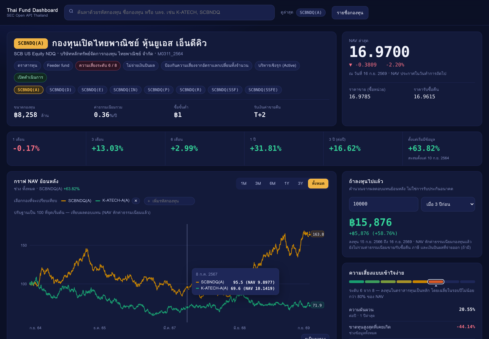

# Thai Fund Dashboard — Dashboard กองทุนไทย ครบจบในหน้าเดียว

ดึงข้อมูลกองทุนรวมไทยจาก **SEC Open Data API (v2)** มาแสดงเป็น dashboard หน้าเดียว:
NAV ล่าสุด · ผลตอบแทนทุกช่วงเวลา · ค่าความเสี่ยง · กราฟ NAV ย้อนหลัง · พอร์ตการลงทุน ·
ค่าธรรมเนียม และ **เปรียบเทียบหลายกองทุนบนกราฟเดียวกัน**

พิมพ์ชื่อย่อกองทุน เช่น `K-ATECH`, `SCBNDQ` แล้วกด Enter — ข้อมูลขึ้นครบในไม่กี่วินาที



> ภาพด้านบนถ่ายจาก **โหมดสาธิต** ตัวเลขเป็นข้อมูลจำลอง ไม่ใช่ข้อมูลจริงของกองทุน

---

## 1. ขอ API Key จาก ก.ล.ต. ก่อน

1. เข้า <https://secopendata.sec.or.th/> แล้ว **Register**
2. เข้าเมนู Subscribe / Product แล้วสมัครใช้กลุ่มข้อมูล **Fund**
3. คัดลอก **Subscription Key** มาเก็บไว้ (ทุก request ต้องส่ง header `Ocp-Apim-Subscription-Key`)

> SEC ย้ายมาใช้ portal และ endpoint ชุดใหม่ (`https://api.sec.or.th/v2/fund/...`)
> โค้ดเดิมที่เรียก `/FundFactsheet/...` หรือ `/FundDailyInfo/...` แบบเก่าจะใช้ไม่ได้แล้ว

## 2. ติดตั้งและรัน

ต้องมีแค่ **Python 3.10 ขึ้นไป** — ไม่ต้อง `pip install` อะไรเลย (ใช้ standard library ล้วน
และกราฟทั้งหมดวาดด้วย SVG เอง ไม่ได้พึ่ง Chart.js หรือ CDN)

```bash
cd fund_dashboard
cp .env.example .env          # แล้วใส่ SEC_API_KEY ของตัวเองลงไป
python3 server.py             # เปิด http://127.0.0.1:8765
```

อยากลองหน้าตาก่อนได้ API Key:

```bash
python3 server.py --demo      # ข้อมูลจำลองทั้งหมด ไม่ต้องใช้ key
```

ทางเลือกเพิ่มเติม (ทำครั้งเดียว ช่วยให้ช่องค้นหาและปุ่ม "รายชื่อกองทุน" ทำงานเต็มที่):

```bash
python3 catalog.py --build    # ดึงรายชื่อกองทุนที่ยัง active ทั้งหมดมาเก็บไว้ในเครื่อง
python3 catalog.py --peers    # คำนวณผลตอบแทน "กลุ่มเดียวกัน" ไว้เทียบใต้ตัวเลขผลตอบแทน
```

## 2.1 ทดสอบว่าดึงข้อมูลได้จริง

ก่อนเปิด dashboard แนะนำให้รันตัวทดสอบก่อน จะได้รู้ว่า key ใช้ได้ไหม และ endpoint ไหนมีข้อมูล

```bash
python3 selftest.py              # ทดสอบกับ API จริง (ใช้ K-ATECH เป็นกองตัวอย่าง)
python3 selftest.py SCBNDQ       # เปลี่ยนกองที่ใช้ทดสอบ
python3 selftest.py --demo       # ทดสอบ pipeline ด้วยข้อมูลจำลอง ไม่ต้องใช้ key
python3 selftest.py --spec       # ตรวจว่า endpoint/ฟิลด์ที่โค้ดใช้ ยังตรงกับสเปกล่าสุดของ SEC
```

สคริปต์จะไล่ทำ 4 อย่าง: (1) ยืนยัน API Key, (2) ค้นหากองทุนจากชื่อย่อ, (3) ยิงทีละ endpoint
แล้วรายงานจำนวนแถว เวลาที่ใช้ และฟิลด์ที่หายไป, (4) ประกอบข้อมูลชุดเต็มแล้วตรวจความสมเหตุสมผล
ของตัวเลข (NAV เป็นบวก, วันที่เรียงถูก, ผลตอบแทน/ความผันผวนอยู่ในช่วงที่เป็นไปได้)

`--spec` มีไว้สำหรับตอน SEC ประกาศเปลี่ยน API อีก: มันเทียบ endpoint, query parameter และชื่อฟิลด์
ที่โค้ดใช้ กับสเปกทางการ แล้วฟ้องจุดที่ไม่ตรง — รู้ก่อนที่ dashboard จะพัง

## 3. ในหน้า dashboard มีอะไรบ้าง

| ส่วน | ข้อมูลที่แสดง | มาจาก endpoint |
|---|---|---|
| หัวกองทุน | ชื่อไทย/อังกฤษ, บลจ., เลขที่โครงการ, ชนิดหน่วยลงทุน (class), นโยบาย, ระดับความเสี่ยง, ขนาดกองทุน, ค่าธรรมเนียมรวม, ซื้อขั้นต่ำ, T+n | `general-info/profiles`, `factsheet/risk-spectrum`, `factsheet/fees`, `factsheet/subscription-redemption-*` |
| NAV ล่าสุด | NAV/หน่วย, เปลี่ยนแปลงวันล่าสุด, ราคาขาย/รับซื้อคืน, วันที่ประกาศ | `daily-info/nav` |
| ผลตอบแทน | 1M / 3M / 6M / 1Y / 3Y (ต่อปี) / สะสมทั้งช่วง + ค่ากลางของกองกลุ่มเดียวกัน | คำนวณจาก NAV จริง |
| กราฟ NAV | กราฟย้อนหลัง 1M–ทั้งหมด, hover ดูค่าแต่ละวัน, ใส่กองอื่นเทียบได้ (ปรับฐาน 100), สลับดูเป็นตาราง | `daily-info/nav` |
| ถ้าลงทุนไปแล้ว | ใส่เงินต้น + ช่วงเวลา แล้วดูว่าวันนี้เป็นเท่าไร | คำนวณจาก NAV จริง |
| ความเสี่ยง | ระดับความเสี่ยง 1–8, ความผันผวนต่อปี, ขาดทุนสูงสุด, Sharpe, ระยะเวลาฟื้นตัว | `factsheet/risk-spectrum` + คำนวณเอง |
| ผลการดำเนินงาน (factsheet) | ผลตอบแทนกองทุน vs benchmark และความผันผวน แยกตามช่วงเวลา | `factsheet/performance` |
| ค่าสถิติ | Sharpe, beta, alpha, tracking error, max drawdown, portfolio turnover เทียบกับที่ dashboard คำนวณเอง | `factsheet/statistics` |
| พอร์ตการลงทุน | สัดส่วนประเภททรัพย์สิน + ทรัพย์สิน 5 อันดับแรก | `factsheet/asset-allocation`, `factsheet/top5-holdings` |
| ค่าธรรมเนียม / เงื่อนไข | เพดานและอัตราที่เก็บจริง, ซื้อ-ขายคืนขั้นต่ำ, วันทำการ, ระยะเวลารับเงิน, ปันผลย้อนหลัง | `factsheet/fees`, `general-info/mutual-fund-fees`, `daily-info/dividend-history` |
| เปรียบเทียบกองทุน | ตารางผลตอบแทน/ความผันผวน/Max drawdown/Sharpe ของหลายกองในหน้าต่างเวลาเดียวกัน | รวมทุกอย่างข้างบน |

## 4. โครงสร้างโค้ด

```
fund_dashboard/
├── sec_api.py        # client ของ SEC Open API: auth, cursor pagination, cache, retry
├── fund_service.py   # รวมข้อมูลหลาย endpoint ให้เป็นก้อนเดียวที่หน้าเว็บใช้ได้เลย
├── metrics.py        # คำนวณผลตอบแทน/ความผันผวน/drawdown/Sharpe/Sortino จาก NAV
├── catalog.py        # สร้างรายชื่อกองทุนทั้งหมด + ค่ากลางของกองกลุ่มเดียวกัน
├── demo_data.py      # ข้อมูลจำลองสำหรับโหมด --demo
├── selftest.py       # ทดสอบการดึงข้อมูลจริง + ตรวจโครงสร้าง API กับสเปกของ SEC
├── build_static.py   # build เว็บ static (ไฟล์ JSON) สำหรับ deploy ขึ้น GitHub Pages
├── watchlist.txt     # รายชื่อกองทุนที่จะ build ขึ้น Pages
├── server.py         # เว็บเซิร์ฟเวอร์ (stdlib) + REST API ของ dashboard
└── static/           # หน้าเว็บ: index.html, styles.css, app.js (กราฟ SVG เขียนเอง)
```

ทำไมต้องมี backend แทนที่จะให้หน้าเว็บยิง SEC API ตรง ๆ: **API Key จะได้ไม่หลุดไปอยู่ในหน้าเว็บ**,
เลี่ยงปัญหา CORS, และรวม/คำนวณข้อมูลให้เสร็จก่อนส่งไปวาดกราฟ

### REST API ของ dashboard เอง

| path | ใช้ทำอะไร |
|---|---|
| `GET /api/search?q=` | ค้นกองทุนสำหรับ auto-complete |
| `GET /api/fund?code=K-ATECH&class=&years=5` | ข้อมูลกองทุน 1 กองแบบครบชุด |
| `GET /api/compare?codes=A,B,C&window=1Y` | เปรียบเทียบหลายกองทุน |
| `GET /api/funds?q=&amc=&policy=` | รายชื่อกองทุน (ต้อง `catalog.py --build` ก่อน) |
| `GET /api/meta` | สถานะระบบ: โหมด demo, catalog, peer group |

เอาไปต่อยอดเป็น Excel/Power BI/Google Sheets ได้เลย เพราะทุก endpoint ตอบเป็น JSON

## 5. รันบน GitHub (ไม่ต้องเปิดคอมเองตลอด)

### วิธีที่แนะนำ: GitHub Actions ดึงข้อมูล + GitHub Pages เสิร์ฟหน้าเว็บ (ฟรี)

```
GitHub Actions (ตามเวลาที่ตั้งไว้)          GitHub Pages
  ├─ อ่าน SEC_API_KEY จาก Secrets    →   เว็บ static อ่านไฟล์ JSON
  ├─ ดึงข้อมูลจาก SEC Open API            ไม่มีการเรียก SEC API จากเบราว์เซอร์
  └─ build เป็นไฟล์ JSON + หน้าเว็บ        จึงไม่เปิด API Key ให้ใครเห็น
```

ตั้งค่าครั้งเดียว:

1. **ใส่ API Key เป็น Secret** — Settings → Secrets and variables → Actions → New repository secret
   ชื่อ `SEC_API_KEY` ค่าคือ key จาก SEC *(ห้าม commit key ลงโค้ดหรือไฟล์ `.env` เด็ดขาด)*
2. **เปิด Pages** — Settings → Pages → Source เลือก **GitHub Actions**
3. **เลือกกองทุนที่อยากติดตาม** — แก้ไฟล์ `fund_dashboard/watchlist.txt` (บรรทัดละ 1 กอง)
4. กด Run workflow ที่แท็บ Actions หรือรอรอบถัดไป (workflow ตั้งไว้ 20:30 น. เวลาไทย จันทร์–ศุกร์)

เสร็จแล้วจะได้ลิงก์ `https://<ชื่อผู้ใช้>.github.io/<ชื่อ repo>/` เอาไปแชร์ได้เลย
ถ้ายังไม่ได้ใส่ secret workflow จะ build ด้วยข้อมูลจำลองให้ดูหน้าตาก่อน

สร้างไฟล์เองในเครื่องก็ได้ (ไว้ทดสอบก่อน push):

```bash
python3 build_static.py --demo --out ../site     # ข้อมูลจำลอง
python3 build_static.py --out ../site            # ข้อมูลจริง
python3 -m http.server 8080 --directory ../site  # เปิด http://127.0.0.1:8080
```

**ข้อจำกัดของเวอร์ชัน static**: มีข้อมูลเฉพาะกองทุนที่อยู่ใน `watchlist.txt` (ค้นกองอื่นไม่ได้
เพราะไม่มี backend คอยยิง API ให้) และข้อมูลใหม่ตามรอบที่ workflow รัน ไม่ใช่เรียลไทม์
ขนาดไฟล์ราว 65 KB ต่อกอง (NAV ย้อนหลัง 5 ปี) — 6 กองประมาณ 400 KB

### วิธีอื่น

| วิธี | เหมาะกับ | ข้อสังเกต |
|---|---|---|
| **GitHub Codespaces** | อยากได้ของเต็ม (ค้นได้ทุกกอง) โดยไม่ลงอะไรในเครื่อง | เปิด Codespace → `cd fund_dashboard && python3 server.py` → กด Open in Browser ที่พอร์ต 8765 · ใส่ key ไว้ที่ Codespaces secrets · ใช้ได้เฉพาะตอนเปิด Codespace และมีโควตาชั่วโมงฟรีจำกัด |
| **โฮสต์ที่อื่นโดย deploy จาก repo นี้** (Render / Railway / Fly.io) | อยากได้เว็บที่ค้นได้ทุกกอง เปิดได้ตลอด | รันคำสั่ง `python3 fund_dashboard/server.py --host 0.0.0.0 --port $PORT` ใส่ `SEC_API_KEY` เป็น environment variable ของบริการนั้น · ควรใส่การจำกัดการเข้าถึงด้วย เพราะทุกคนที่เปิดเว็บจะใช้โควตา API ของเรา |
| **GitHub Pages อย่างเดียว (ไม่มี Actions)** | — | ไม่แนะนำ: ต้องให้เบราว์เซอร์ยิง SEC API ตรง ๆ ซึ่งแปลว่า API Key จะอยู่ในหน้าเว็บให้ใครก็เห็น และมีโอกาสติด CORS |

> ก่อนเผยแพร่ข้อมูลกองทุนขึ้นเว็บสาธารณะ ควรอ่านเงื่อนไขการใช้ข้อมูลของ SEC Open Data
> และให้เครดิตแหล่งข้อมูลไว้บนหน้าเว็บ (หน้านี้ใส่ไว้ที่ footer ให้แล้ว)

## 6. หมายเหตุสำคัญ

- **cache**: ผลลัพธ์จาก SEC API ถูก cache ลง `fund_dashboard/cache/` (NAV 6 ชม., factsheet 24 ชม.)
  ลบทิ้งได้ถ้าอยากดึงใหม่ทั้งหมด — โฟลเดอร์นี้และไฟล์ `.env` ไม่ถูก commit ขึ้น git
- **NAV ย้อนหลัง** ดึงมา 5 ปีเป็นค่าเริ่มต้น ปรับได้ที่ `SEC_HISTORY_YEARS` ในไฟล์ `.env`
  (กองที่ตั้งมานานกว่านั้น ช่อง "ตั้งแต่เริ่มมีข้อมูล" จะนับจากวันแรกที่ดึงมา ไม่ใช่วันจัดตั้งจริง)
- **Class fund**: กองที่มีหลายชนิดหน่วยลงทุน (เช่น `SCBNDQ(A)`, `SCBNDQ(SSF)`) NAV และค่าธรรมเนียม
  ต่างกัน — กดเลือก class ที่ต้องการได้จากแถบใต้ชื่อกองทุน
- **ตัวเลขที่คำนวณเอง** (ความผันผวน, Sharpe, Sortino, max drawdown) คำนวณจาก NAV รายวันที่ SEC เผยแพร่
  ซึ่งเป็น NAV หลังหักค่าธรรมเนียมกองทุนแล้ว แต่ **ยังไม่รวมเงินปันผลที่จ่ายออก** จึงอาจต่างจากตัวเลขใน
  factsheet ที่ บลจ. รายงาน (ซึ่งเป็น total return) — กองที่จ่ายปันผลบ่อยจะเห็นผลตอบแทนต่ำกว่าความจริง
  เล็กน้อย ตารางฝั่ง factsheet มีไว้เทียบกันด้วยเหตุผลนี้
- **ผลการดำเนินงานในอดีตไม่ได้เป็นสิ่งยืนยันผลการดำเนินงานในอนาคต** — โปรเจกต์นี้ทำเพื่อการศึกษา
  ไม่ใช่คำแนะนำการลงทุน และไม่ได้มีความเกี่ยวข้องกับสำนักงาน ก.ล.ต.

## 7. ปัญหาที่เจอบ่อย

| อาการ | สาเหตุ / วิธีแก้ |
|---|---|
| `SEC API ปฏิเสธการเข้าถึง (401/403)` | key ผิด หรือยังไม่ได้ subscribe product กลุ่ม Fund ที่ portal |
| ค้นหาแล้วไม่เจอกองทุน | ลองใส่ชื่อย่อให้ตรง เช่น `K-ATECH` ไม่ใช่ `KATECH` หรือรัน `catalog.py --build` เพื่อค้นจากรายชื่อในเครื่อง |
| ตัวเลขผลตอบแทนว่าง (—) | กองใหม่ที่ NAV ย้อนหลังยังไม่ครบช่วงเวลานั้น |
| ใต้ตัวเลขผลตอบแทนไม่มี "กลุ่มเดียวกัน" | ยังไม่ได้รัน `python3 catalog.py --peers` |
| ดึงข้อมูลช้าครั้งแรก | ปกติ — ครั้งแรกต้องไล่ NAV ทีละหน้า (หน้าละ 100 แถว) ครั้งต่อไปอ่านจาก cache |
