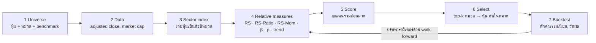

# Workflow: Sector Rotation สำหรับหุ้น

## 1. Universe
- รายชื่อหุ้นและหมวดที่สังกัด (SET: 8 industry groups / 28 sectors; US: GICS 11 sectors)
- Benchmark ที่ลงทุนได้จริงและสกุลเงินเดียวกัน เช่น SET/SET50 (TDEX), SPY, ACWI
- **ต้องใช้รายชื่อสมาชิก ณ วันนั้น (point-in-time)** ถ้าใช้รายชื่อปัจจุบันย้อนหลัง จะเกิด survivorship bias

## 2. Data
| ข้อมูล | ใช้ทำอะไร | แหล่ง |
|---|---|---|
| Adjusted close (รายวัน/สัปดาห์) | ทุกสมการ | Yahoo, SETSMART, Bloomberg |
| Market cap / free-float | ถ่วงน้ำหนักดัชนีหมวดแบบทางการ | SETSMART, Bloomberg |
| ราคาดัชนีหมวดทางการ (ถ้ามี) | ข้ามขั้นที่ 3 ได้เลย | SETSMART, Settrade |
| อัตราแลกเปลี่ยน | ถ้าเทียบข้ามประเทศ | Yahoo `XXX=X` |

## 3. ดัชนีหมวด (Sector index)
ผลตอบแทนหุ้น  r_{i,t} = P_{i,t} / P_{i,t-1} − 1

ดัชนีหมวด  I_t = I_{t-1} · (1 + Σ_i w_{i,t-1} · r_{i,t})

- Equal weight: w_i = 1/N
- Cap weight: w_i = MC_{i,t-1} / Σ MC_{j,t-1} (เหมือนดัชนีทางการ)
- ใช้น้ำหนัก ณ t−1 เสมอ เพื่อไม่ให้ใช้ข้อมูลอนาคต

## 4. สมการความสัมพันธ์ (Relative measures)
| ชื่อ | สมการ | ตีความ |
|---|---|---|
| Relative strength | RS_t = 100 · I_t / B_t | เส้นขึ้น = ชนะ benchmark |
| RS-Ratio | 100 + (RS_t − μ_n(RS)) / σ_n(RS) | แนวโน้มเชิงเปรียบเทียบ (แกน X ของ RRG) |
| RS-Momentum | 100 + (Ratio_t − μ_n(Ratio)) / σ_n(Ratio) | ความเร็วของแนวโน้ม (แกน Y) |
| Quadrant | Leading (≥100,≥100), Weakening (≥100,<100), Lagging (<100,<100), Improving (<100,≥100) | ปกติหมุนตามเข็มนาฬิกา |
| Heading | θ = atan2(ΔMom, ΔRatio) | 0–90° = NE ดีขึ้นทั้งสองแกน |
| Excess return | (1+R_i)/(1+R_B) − 1 | ผลตอบแทนส่วนเกินแบบ geometric |
| Momentum 12-1 | P_{t−4} / P_{t−52} − 1 | industry momentum (Moskowitz & Grinblatt 1999) |
| Beta | β = Cov(r_i, r_B) / Var(r_B) | ความไวต่อตลาด, ใช้คุมความเสี่ยง |
| Correlation | ρ = Cov(r_i, r_B) / (σ_i σ_B) | ρ ต่ำ = ช่วยกระจายความเสี่ยง |
| Trend filter | 1 ถ้า I_t > SMA(I, 40 สัปดาห์) | ตัดหมวดที่อยู่ในขาลงแบบสัมบูรณ์ |

สูตร JdK RS-Ratio ต้นฉบับไม่เปิดเผย สูตร z-score ข้างบนเป็นสูตรทดแทนที่ใช้กันทั่วไป

## 5. คะแนนรวม (Score)
S_i = 0.4·z_cs(RS-Ratio) + 0.3·z_cs(RS-Mom) + 0.2·z_cs(Mom 12-1) + 0.1·QuadrantScore

- z_cs = z-score ข้ามหมวด ณ วันเดียวกัน ทำให้แต่ละตัวแปรเทียบกันได้
- QuadrantScore: Improving 1.0, Leading 0.75, Weakening −0.5, Lagging −0.75

## 6. การเลือก (Top-down)
1. เลือก top-k หมวดตาม S (เช่น k = 3)
2. ในแต่ละหมวด ใช้ RRG ระดับหุ้นเลือก 1–2 ตัวที่ RS-Ratio และ RS-Mom สูงสุด
3. สัญญาณ ณ ปลายงวด t ใช้กับผลตอบแทนงวด t+1 เท่านั้น

## 7. Backtest และการวัดผล
- R_p,t+1 = Σ w_{i,t} · r_{i,t+1} − c · Turnover_t,   Turnover_t = ½ Σ |w_{i,t} − w_{i,t−1}|
- CAGR = (Π(1+r))^{52/N} − 1, Sharpe = mean/σ · √52, MaxDD = min(NAV/peak − 1)
- Information ratio = mean(r_p − r_B) / σ(r_p − r_B) · √52
- เทียบกับ 2 ตัวอ้างอิงเสมอ: benchmark และ "ถือทุกหมวดเท่ากัน" เพื่อแยกผลของการเลือกออกจากผลของการถ่วงเท่ากัน

## ผลทดสอบตัวอย่าง (SET 14 หมวด, ต.ค. 2017 – ต.ค. 2026, ค่าธรรมเนียม 15 bps)
| ชุดทดสอบ | Rebalance | CAGR กลยุทธ์ | IR | CAGR ถือทุกหมวด | CAGR TDEX |
|---|---|---|---|---|---|
| ครบ 14 หมวด | 4 สัปดาห์ | 13.2% | 0.63 | 5.4% | 4.4% |
| ครบ 14 หมวด | 13 สัปดาห์ | 10.7% | 0.47 | 5.4% | 4.4% |
| ตัด ETRON | 4 สัปดาห์ | 6.4% | 0.18 | 3.6% | 4.4% |
| ตัด ETRON | 13 สัปดาห์ | 4.6% | 0.06 | 3.6% | 4.4% |
| ใส่ trend filter | 4 สัปดาห์ | 8.8% | 0.30 | 5.4% | 4.4% |

ผลส่วนใหญ่มาจากหมวด ETRON ตัวเดียว และหมวดนี้ใช้รายชื่อหุ้นปัจจุบันย้อนหลัง จึงมี survivorship bias ตัวเลขนี้จึงเป็นขอบบน ไม่ใช่ผลที่คาดหวังได้

## ข้อควรระวัง
1. Survivorship bias: ใช้รายชื่อสมาชิก point-in-time
2. Look-ahead bias: สัญญาณ t → ผลตอบแทน t+1, น้ำหนัก t−1
3. Overfitting: เลือก window / k / รอบ rebalance ด้วย walk-forward ไม่ใช่ทั้งช่วง
4. ค่าธรรมเนียมและสภาพคล่อง: หุ้นเล็กในบางหมวดซื้อขายจริงไม่ได้ตามราคาปิด
5. Concentration: หมวดที่มีหุ้นตัวใหญ่ตัวเดียว (DELTA, PTT, CPALL) จะสะท้อนหุ้นตัวนั้น

## ไฟล์
- `fetch_prices.py`  ดึงราคาจาก Yahoo
- `sector_rotation.py`  ขั้นที่ 1–7 ทั้งหมด: `python sector_rotation.py --top 3 --rebalance 4 [--trend-filter]`
- `build_data.py`, `build_page.py`  สร้างหน้า RRG Studio
